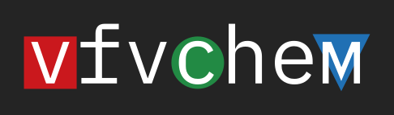

# **Vertex-Centered Finite Volume Method Solver for Chemical Engineering Applications (VFVChem)**
2D Finite Volume Method Solver Module
Copyright (c) 2026 VFVChem Development Team

## Overview
VFVChem is a vertex-centered finite volume method (FVM) solver for chemical engineering systems.
- Simulate coupled heat, mass, and/or momentum transfer problems
- Allows for **non-constant properties** and **multiple regions**.
- Input files are **pure Rust scripts** that run with Cargo.

**Note:** The project is under active development. The API and numerical models may change between releases.

## Features
### Simulations for chemical engineering systems:
- Transient simulations may have fixed or adaptive time steps.
- Inputs may be non-constant (e.g., reaction rates, temperature/concentration-dependent properties, etc.)
- Mass transfer may have multiple components.

### Complex geometries with multiple regions:
- Geometries may have multiple domains, boundaries, and interfaces.
- Custom geometries may be imported from `.obj` files. Voronoi vertices are generated automatically.
- Supports heat and mass transfer across interfaces.

### Numerical formulation:
- Uses a non-conservative formulation for stability.
- Advection uses a Venkatakrishnan limiter to prevent excessive numerical damping.
- Pressure stabilization uses a modified Rhie-Chow formulation for simpler implementation.
- Time stepping uses the 2nd-order backward differentiation formula (BDF2) to allow for large time steps without excessive damping.

## Examples
Download the project, change to the `vfvchem_vfvm2d` directory, and run the `quickstart.rs` example:
```sh
cargo run --release --example quickstart
```

Other examples may be found in the `examples` folder. A brief description of these is provided in [`examples/readme_examples.md`](examples/readme_examples.md).

## Source Code
The source code may be found in the `src` folder. An overview of the software architecture and numerical framework is provided in [`src/readme_src.md`](src/readme_src.md).

## AI Usage
The author wrote the majority of the code, and independently developed the software architecture and numerical framework of this solver.
Generative AI tools were used for consultation, debugging, prototyping, and minor code editing.

## Contributing
Due to limited maintenance capacity, we are not currently accepting external contributions. However, users are welcome to fork and modify the repository in accordance with the MIT License.

## License
This software is available under the MIT License. See [`license.txt`](license.txt) for details.
